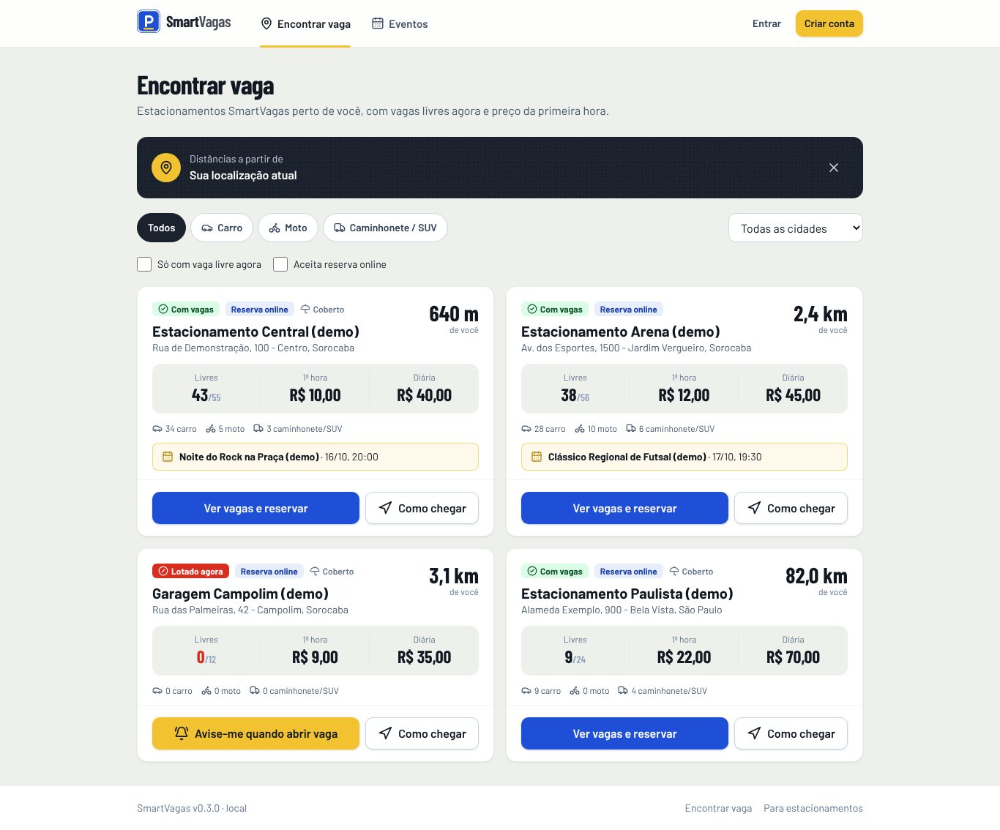
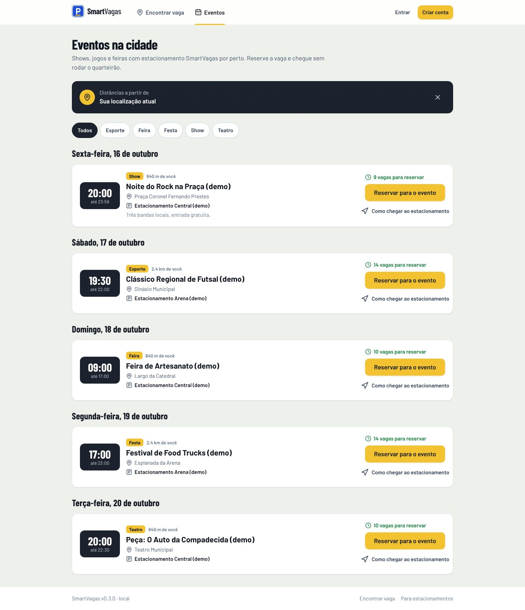
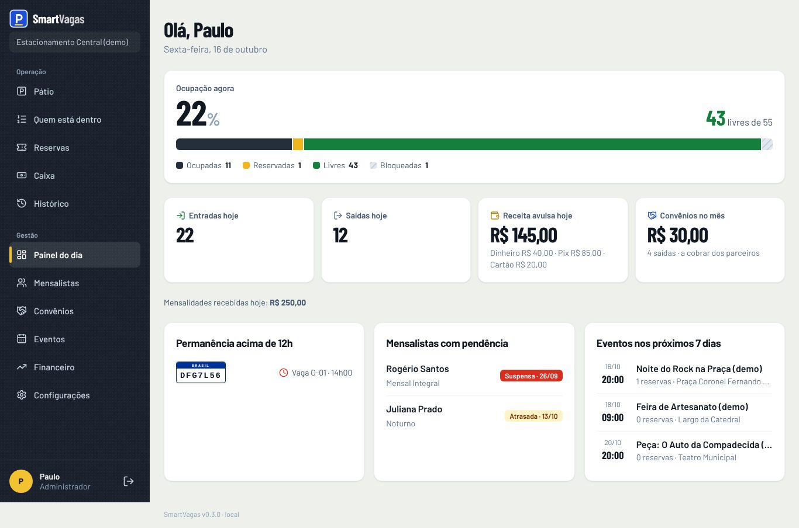
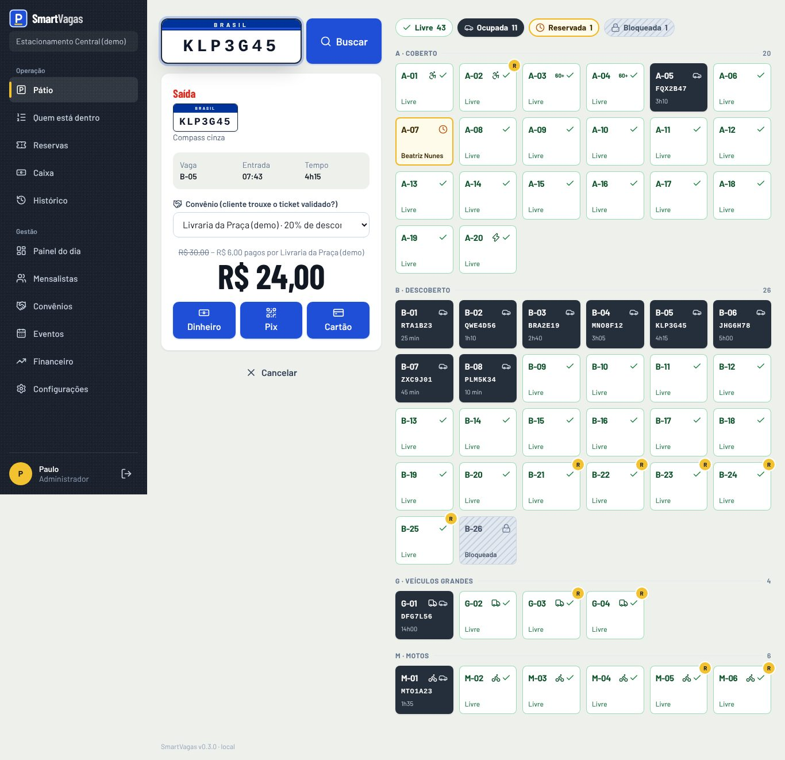

<div align="center">

# 🅿️ SmartVagas

**Encontre e reserve vaga perto de você. E, para quem tem estacionamento,**
do pátio ao lucro do mês num lugar só.

[](https://github.com/mateusnchaves/SmartVagas/actions/workflows/ci.yml)


</div>

---

## O problema

O dono de um estacionamento pequeno de centro costuma controlar tudo em papel, caderno ou WhatsApp.
Ele não sabe quem está dentro, perde vaga para mensalista inadimplente, o operador demora no horário
de pico e o lucro real, descontando salários e contas, nunca fica claro. Do outro lado, o motorista
roda o quarteirão sem saber onde tem vaga, ainda mais em dia de show ou de jogo.

## A solução

Um sistema web, pensado para o celular e para o PC do guichê, com dois lados:

- **Motorista:** encontra estacionamentos SmartVagas por perto (com a distância em km), filtra pelo
  tipo de veículo, vê os eventos da cidade, reserva antes de sair de casa e é avisado quando abre
  vaga ou quando o horário está acabando.
- **Estacionamento:** opera o pátio inteiro (entrada e saída pela placa, caixa, mensalistas,
  financeiro), organiza convênios com lojas, shoppings e eventos e divulga eventos para vender vaga
  antes.

## Funcionalidades

### 🚗 Motorista (portal do cliente)

| | |
|---|---|
| **Encontrar vaga** | Lista dos estacionamentos SmartVagas com a **distância em km** a partir do GPS do celular ou de um endereço digitado, vagas livres agora, preço da 1ª hora e da diária, e botão "Como chegar". |
| **Filtro por veículo** | Carro, moto ou **caminhonete/SUV** (vaga grande). Só aparece onde o veículo cabe, com a contagem de vagas livres para ele. Também filtra por cidade, "só com vaga livre" e "aceita reserva". |
| **Eventos da cidade** | Agenda de shows, jogos, feiras e peças perto dos estacionamentos, com a distância, as vagas reserváveis livres no horário e o botão **Reservar para o evento** (horário já preenchido com folga). |
| **Reserva** | Em qualquer estacionamento, com código curto, pagamento por Pix e cancelamento com reembolso conforme o prazo do dono. |
| **Aviso de taxa adicional** | Antes de reservar, o motorista vê quanto custa passar do horário. Na reserva em andamento, uma contagem mostra quanto tempo falta e, se passar, **a taxa adicional já acumulada**. |
| **Esgotamento** | Estacionamento sem vaga aparece como **Lotado agora**. O motorista toca em **Avise-me quando abrir vaga** e recebe o aviso na próxima saída do pátio. Reserva sem vaga no horário mostra "Esgotado" com alternativas. |
| **Central de avisos** | Vaga liberada, pagamento confirmado, reserva cancelada pelo estacionamento e horário acabando. |
| **Veículos** | Cadastro de placas com o tipo (carro, moto, caminhonete/SUV), válidos em qualquer estacionamento. |

### 🧑‍💼 Administrador do estacionamento

- **Cadastro do próprio estacionamento** (`/cadastro/parceiro`): cria o estacionamento, as vagas e o
  acesso de administrador. Começa fora da busca até o dono revisar preços e localização.
- **Painel do dia:** ocupação em uma barra (ocupadas, reservadas, livres, bloqueadas), entradas e
  saídas, receita por forma de pagamento, convênios do mês, alerta de **pátio lotado**, quantos
  motoristas esperam vaga, reservas a confirmar, permanência longa, mensalistas com pendência e
  eventos da semana.
- **Convênios:** parceiros (loja, shopping, evento, empresa) com desconto em **minutos grátis**,
  **porcentagem** ou **valor fixo**, validade e pausa. O operador escolhe o convênio na saída; o
  desconto fica gravado e o relatório do mês mostra **quanto cobrar de cada parceiro**.
- **Eventos:** divulga eventos que aparecem na agenda pública com o botão de reservar.
- **Financeiro:** receita − custos = lucro do mês, equipe com encargos, folha com um clique, CSV e o
  total de convênios a receber.
- **Mensalistas, caixa por turno e configurações** (preços, tolerância, regras de reserva, chave Pix,
  vagas, operadores, **localização no mapa** e "aparece na busca").

### 🧑‍🔧 Operador

- **Pátio:** um campo de placa decide entre entrada (com vaga sugerida) e saída (com valor
  calculado, convênio opcional e aviso automático para quem esperava vaga). Placa + Enter + Enter.
- **Mapa de vagas** com cor, ícone e texto, agora com vaga de **veículo grande**.
- Quem está dentro, reservas do guichê, caixa e histórico com lançamento retroativo.

### 🔐 Acesso

O login tem dois caminhos: **Sou motorista** e **Sou do estacionamento** (administrador e operador).
Cada perfil cai na sua área, e o servidor barra o resto (motorista não entra no pátio, operador não
vê convênios nem financeiro).

## Telas

| | |
|---|---|
|  |  |
|  |  |

Todas as telas estão em [`docs/telas/`](docs/telas/).

## Decisões técnicas

| Decisão | Por quê |
|---|---|
| Dinheiro sempre em **centavos (inteiro)** | Nada de erro de arredondamento com `float`. |
| Regras de negócio no **banco**, não no código | O dono muda preço, tolerância e convênios sem deploy. |
| **Diária por bloco de 24h** | Um carro que fica 3 dias paga 3 diárias, não uma. |
| **Índices únicos parciais** no Postgres | Dois operadores não conseguem colocar dois carros na mesma vaga. |
| **Lock na vaga** ao reservar | 8 reservas simultâneas para 5 vagas resultam em 5 reservas, sem duplicar. |
| **RBAC no servidor** em toda action | Operador não vê salário nem lucro, mesmo chamando a API direto. |
| **Auditoria** de tudo que envolve dinheiro | Entrada, saída, convênio aplicado, preço alterado (antes e depois). |
| Mapa com **cor + ícone + texto** | Legível para daltônicos e no sol do pátio. Vermelho só significa problema. |
| **Motorista multi-estacionamento** | Um login, um cadastro de cliente por estacionamento, criado na primeira reserva. Veículos são do login. |
| **Distância calculada no navegador** | A localização do motorista não vai para o servidor. Endereço digitado vira coordenada pelo OpenStreetMap. |
| **Avisos sem cron** | "Abriu vaga" nasce na transação da saída; "horário acabando" nasce quando o motorista abre o app. |
| Convênio **recalculado no servidor** | A tela só mostra a prévia; o valor gravado é sempre o do servidor. |
| Fontes **locais** (Barlow) | Lembram a sinalização viária e não dependem do Google Fonts no build. |

## Stack

- **Next.js 16** (App Router, Server Actions) + **TypeScript** strict
- **Prisma 7** + **PostgreSQL**
- **Better Auth** (e-mail e senha, com rate-limit no banco)
- **Tailwind CSS v4**, componentes próprios, ícones Lucide, fontes Barlow (Fontsource)
- **Zod** para validar toda entrada, **Vitest** para as regras de negócio
- **GitHub Actions**: lint, tipos, testes e build a cada push

## Rodando localmente

Pré-requisito: **Node 22+**. Docker é opcional.

```bash
npm install
cp .env.example .env
```

No `.env`, troque o `BETTER_AUTH_SECRET` por um texto aleatório de 32+ caracteres e escolha o banco:

- **Sem Docker (mais simples):** descomente as linhas de `DATABASE_URL` e `SHADOW_DATABASE_URL` da seção "Sem Docker". O próprio Prisma sobe um Postgres local.
- **Com Docker:** rode `docker compose up -d` e mantenha a `DATABASE_URL` padrão.

Crie as tabelas e os dados de demonstração:

```bash
npm run db:migrate
npm run db:seed
```

E rode:

```bash
npm run dev
```

Abra **http://localhost:3000**.

### Dados e logins de demonstração

O seed cria 4 estacionamentos (3 em Sorocaba e 1 em São Paulo, um deles **lotado** para testar o
"Avise-me"), 5 eventos, 4 convênios, mensalistas, carros no pátio e uma motorista com reservas.

| Perfil | E-mail | Senha |
|---|---|---|
| Administrador (Estacionamento Central) | `dono@smartvagas.test` | `SEED_SENHA_DONO` do `.env` |
| Operador | `operador@smartvagas.test` | `SEED_SENHA_OPERADOR` do `.env` |
| Motorista | `motorista@smartvagas.test` | `SEED_SENHA_MOTORISTA` do `.env` |
| Administradores dos outros | `dono+arena@`, `dono+campolim@`, `dono+paulista@smartvagas.test` | `SEED_SENHA_DONO` |

Em desenvolvimento, a tela de login mostra essas contas.

## Scripts

| Comando | O que faz |
|---|---|
| `npm run dev` | Banco local + site em modo desenvolvimento |
| `npm test` | Testes das regras de negócio |
| `npm run typecheck` · `npm run lint` | Tipos e lint |
| `npm run db:migrate` | Aplica migrations em desenvolvimento |
| `npm run db:seed` | **Apaga tudo** e recria os dados de demonstração |
| `npm run build` | Build de produção |

## Estrutura

```
src/
  app/
    (publico)/           encontrar vaga, eventos e página de cada estacionamento (sem login)
    (cliente)/cliente/   portal do motorista: início, reservas, reservar, veículos, avisos
    (painel)/            pátio, painel do dia, convênios, eventos, financeiro, configurações...
    login, cadastro, cadastro/parceiro, inicio (redireciona cada perfil)
  features/<dominio>/    regras puras + testes, queries, actions e telas de cada domínio
                         (estadias, vagas, reservas, explorar, eventos, convenios, avisos, parceiros...)
  server/                banco, autenticação, sessão/permissões e auditoria
  lib/                   utilitários puros: tempo, dinheiro, placa, distância, veículo
  components/            componentes de interface e as molduras do painel e do site
prisma/                  schema, migrations e seed
docs/                    especificação do MVP e prints das telas
```

O código de domínio é em português (`estadia`, `vaga`, `convenio`), porque é o vocabulário do negócio.

## Status e próximos passos

- [x] **Fase 1:** pátio, mapa, mensalistas, caixa, financeiro, histórico, configurações
- [x] **Fase 2:** portal do motorista e reservas com proteção contra overbooking
- [x] **Fase 3:** busca por distância, filtro por veículo, eventos, convênios, avisos de esgotamento e de horário, cadastro de estacionamento
- [ ] Pix automático via gateway (hoje o guichê confirma o pagamento da reserva)
- [ ] Notificação push e WhatsApp (hoje os avisos ficam na central do app)
- [ ] Mapa interativo na busca
- [ ] Testes end-to-end com Playwright no CI
- [ ] Deploy em produção

A especificação original, com as regras de negócio e o histórico de decisões, está em
[`docs/MVP_v1.1.md`](docs/MVP_v1.1.md). O que mudou nesta versão está no [`CHANGELOG.md`](CHANGELOG.md).

---

<div align="center">
Feito por <a href="https://github.com/mateusnchaves">Mateus Chaves</a>
</div>
